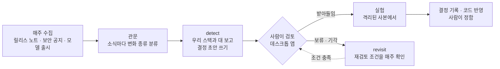

# Decision Radar

내 코드에 닿는 기술 변화를 매주 골라 결정 초안으로 올리고, 사람이 받아들인 결정을 실험까지 이어 주는 도구입니다.

*Each week, Decision Radar picks out the library and model changes that actually touch my code, drafts decision records (ADRs) for them, and carries the ones a human accepts into isolated experiments. Docs are in Korean.*

## 문제: 혼자서는 내 코드에 닿는 변화를 놓칩니다

내가 쓰는 라이브러리와 모델은 매주 새 버전이 나옵니다. 레이더가 한 주에 모으는 소식은 2,300\~3,100건입니다. 그중 내 코드에 실제로 닿는 것은 스무\~서른 건뿐인데, 사람이 매주 그걸 골라낼 수는 없습니다.

실제로 놓친 적이 있습니다. 데스크톱 앱이 쓰던 Electron 39는 5월 5일 마지막 릴리스 뒤로 보안 수정이 끊겼는데, 저는 반년 가까이 몰랐습니다. 그 사이 지원 중인 버전에는 릴리스가 120번 나왔고, 번호가 붙은 보안 취약점(CVE) 수정만 40건이었습니다.

## 하는 일



- **관문**: 수천 건의 소식을 보안 · 호환 깨짐 · 지원 종료 같은 변화 종류로 분류해 볼 것만 남깁니다. 정답 118건으로 모델을 견줘 고른 Claude Haiku가 묶음 10건씩 봅니다.
- **detect**: 에이전트가 남은 소식을 우리 스택의 의존성 표와 대 보고 결정 초안(ADR)을 씁니다. 영향 범위 · 근거 · 상태 같은 틀리면 안 되는 칸은 프롬프트가 아니라 코드(`radar.py` · `product/radar/`)가 맞춥니다.
- **검토**: 초안은 데스크톱 앱 Inbox로 옵니다. 받아들이거나 기각하는 결정은 사람이 합니다. 레이더는 결정 기록의 상태를 바꾸지 않습니다.
- **실험**: 받아들인 결정은 앱에서 「실험해 보기」로 바로 잽니다. 버전 올림은 대상 프로젝트의 격리된 사본에서 기존 검사를 앞뒤로 돌리고, 통과하면 PR 초안을 엽니다. 임베딩 교체는 검색 정답지로 지금 모델과 짝 비교합니다.
- **revisit**: 보류하거나 기각한 결정에는 "이게 바뀌면 다시 본다"는 조건을 적어 둡니다. 레이더가 매주 그 조건을 확인합니다.

## 성과

자세한 숫자와 근거는 [`docs/outcome.md`](docs/outcome.md)에 있습니다.

- **지원 종료를 찾아 Electron을 39에서 45로 올렸습니다.** 레이더가 엉뚱한 버전의 지원 종료 공지를 올린 것을 따라가다 찾았습니다. 그 뒤 레이더가 우리 버전 숫자를 알고 판단하도록 고쳤습니다.
- **레이더가 올린 버전 올림을 앱에서 실험하고 실제로 반영했습니다.** FastAPI 0.162.6이 첫 사례입니다. 레이더가 올린 Node 보안 릴리스 대응(Electron 45.4.1)은 그때 실험이 npm을 못 다뤄서 손으로 올렸고, 그 일을 계기로 npm 의존성도 앱에서 실험하게 만들었습니다.
- **레이더가 올린 새 모델을 실제 평가셋으로 재고 바꾸지 않기로 했습니다.** Gemini 4 두 모델을 진료 도우미 앱의 추출 평가 88호출로 쟀습니다. 정확도는 가장 좋은 비교 기준과 같았지만 운영 모델보다 7배 느리고 3~4배 비쌌습니다.
- **놓친 것도 기록합니다.** 예를 들어 Qwen3-Embedding은 레이더가 올리지 못했습니다. 따로 재 보니 지금 쓰는 BGE-M3보다 낫다고 할 수 없었고, 문서 인코딩은 2.6배 느렸습니다.

## 결정 기록 예시

레이더가 쓴 초안이 사람 결정을 거쳐 어떻게 남는지 보여 주는 실제 기록 세 건입니다. 결정 기록 레포에서 그대로 옮겼습니다([`docs/examples/adr/`](docs/examples/adr/)).

| 기록 | 레이더가 올린 것 | 사람이 정한 것 |
|---|---|---|
| [0017 FastAPI 0.162.6](docs/examples/adr/0017-fastapi.md) | Python 3.10 지원 중단이 든 릴리스 대응 초안 | 채택. 앱 실험이 격리된 사본에서 기존 검사를 앞뒤로 통과시켰고, 그 PR을 merge했습니다 |
| [0024 Electron · Node 보안 릴리스](docs/examples/adr/0024-electron.md) | Node 24.x 보안 릴리스가 Electron에 번들된 Node에 닿는지 검토 | 채택. Electron 45.4.1(Node 24.22.3)로 올리고, 앱이 쓰는 Node 서버 API를 점검한 결과도 적었습니다 |
| [0029 Gemini 4 Carbon](docs/examples/adr/0029-gemini-4-carbon.md) | 진료 도우미 앱 평가 후보로 새 모델 검토 | 보류. 정확도는 같지만 느리고 비싸서입니다. 아래 재검토 조건을 레이더가 매주 확인합니다 |

보류한 결정에는 "이게 바뀌면 다시 본다"는 조건을 근거 문장과 함께 남깁니다. 근거 문장이 없는 조건은 코드(`radar.py validate`)가 막습니다. 근거가 입력에 실제로 있는 문장인지는 평가에서 채점합니다.

```yaml
revisit_when:
- id: rv-1
  check_type: web
  condition: Gemini 4 Carbon의 도입 가격 적용 기간(2026-11-30)이 끝난 뒤 공식 가격 페이지의 gemini-4-carbon
    가격이 $2.00/$10.00 per 1M tokens에서 바뀌었는지 확인한다
  source_hint: https://aistudio.google.com/docs/changelog.md#november-10-2026
  basis: available at introductory [pricing](/docs/pricing#gemini-4-carbon) of $2.00
    per 1M input tokens and $10.00 per 1M output tokens through November 30, 2026.
```

## 만들면서 지킨 것

- **안전 규칙은 코드가 집행합니다.** 모델에게 규칙을 더 말하기 전에, 그 규칙을 스크립트로 옮길 수 있는지 먼저 봅니다. 영향 범위가 의존성 표와 다르면 코드가 고칩니다. 근거 없는 판정은 「확인 못 함」으로 돌립니다.
- **통과는 증거가 아닙니다.** 검사마다 일부러 틀린 답(음성 대조)이나 코드를 망가뜨린 변이를 넣어, 잡아야 할 것을 잡는지 확인합니다. 앱 실험이 10초 만에 「통과」를 낸 적이 있는데, 앱 설정이 검사로 새어 핵심 테스트가 처음부터 실패한 가짜 통과였습니다. 그 뒤로는 올리기 전부터 실패한 검사가 있으면 통과라고 하지 않습니다.
- **결과를 보기 전에 기준을 등록합니다.** 검색 실험의 예측과 비교 규칙은 측정 전에 커밋했습니다. 이 사본은 이력째 떼어 내서 커밋 번호는 바뀌었지만, 작성 날짜와 메시지는 그대로라 아래 명령으로 찾을 수 있습니다.

  | 등록한 것 | 작성 날짜 | 찾는 법 | 비공개 레포의 커밋 |
  |---|---|---|---|
  | 검색 실험(Arena) 예측 격자 | 2026-09-29 17:22 | `git log --grep "사전 등록: Retrieval Arena"` | `9e45cd5` |
  | 비교 프로토콜 | 2026-09-29 17:34 | `git log --grep "사전 등록: 스킬"` | `47c9ad2` |
  | 관문 정답지 W41 (측정 전 얼림) | 2026-10-06 17:43 | `git log --grep "레인 A 정답지 W41"` | `7f1eef5` |

## 구조

| 경로 | 내용 |
|---|---|
| `collector/` | 주간 수집 — 출처 설정 · 스냅숏 · 출처 건강 검사 |
| `pipeline/` | 관문 · detect 입력 만들기 · 역할(자리) 질의 · 관심사 질의 · 버전 올려 보기(`tryout.py`) · 실험 실행기(`experiment.py`) |
| `product/radar/` | 에이전트 코어 — detect · revisit · capture 흐름, 직접 쓴 에이전트 루프, 읽기 도구(MCP), 사람 승인 상태 |
| `.claude/skills/jhs-decisions/` | 처음 만든 스킬판(기준선, 얼림)과 `radar.py` — 제품도 부르는 안전 규칙층 |
| `desktop/` | 데스크톱 앱 — Electron · React 화면과 FastAPI 백엔드 |
| `arena/` | 검색 실험 하네스 — 질의 유형별로 검색 방식을 견주는 곳, 임베딩 비교(`compare_embed.py`) |
| `registry/` | 데이터 등록부 — 기술 · 출처 · component · 결정에 이름 하나를 붙이는 RDF · SHACL |
| `eval/` | 평가 러너 · 픽스처 · 합성 케이스 · 실험 기록 |
| `docs/design/` · `docs/decisions/` | 설계 문서(등록 문서 포함) · 결정 경위 |

## 키 없이 돌려 보기

API 키 · 실제 모델 없이 도는 것만 모았습니다. Python 3.12, Node 22.

```bash
python -m venv .venv && source .venv/bin/activate
pip install -r requirements.txt -r product/requirements.txt -r registry/requirements.txt

python product/radar/run_eval.py --stub --synthetic        # 합성 케이스 5개 + 음성 대조 6개
python .claude/skills/jhs-decisions/scripts/test_radar.py  # 안전 규칙층
python desktop/backend/test_backend.py                     # 앱 백엔드 (스텁 · 임시 폴더)
python pipeline/tests/test_tryout.py                       # 버전 올려 보기 + 변이 검사

cd desktop && npm ci && npm run app:pack                   # 데스크톱 앱을 설치본으로 묶기 (스텁 모드, 예시 데이터)
open "dist/mac-arm64/Decision Radar.app"                   # macOS Apple Silicon
```

스텁 통과는 배관이 맞게 이어졌다는 뜻일 뿐, 모델의 판단을 잰 것은 아닙니다.

설치본은 이 레포의 백엔드를 띄웁니다. 묶을 때 레포 위치를 적어 두므로 레포를 옮기면 다시 묶습니다. 설치본 파일은 릴리스에 올리지 않습니다. 묶은 기기의 경로가 들어가고 서명이 ad-hoc이라 다른 기기에서는 돌지 않기 때문입니다. 화면을 고치면서 볼 때는 `npm run dev`를 씁니다. Windows 설치본(`dist\win-unpacked`)은 확인하지 않았습니다.

### 실제 모델로 돌릴 때

실행 엔진은 둘입니다.

- **API 키**(`--engine api`): `.env`의 `ANTHROPIC_API_KEY`로 부릅니다. 다른 사람이 쓰거나 서비스로 돌릴 때는 이 경로를 씁니다.
- **내 Claude Code 로그인**(`--engine claude-cli`): 내 기기에 설치하고 로그인한 공식 `claude` CLI를 `claude -p`로 부릅니다. 이 도구는 인증 정보를 읽거나 저장하지 않습니다. 로그인도 공식 CLI의 흐름(`claude auth login`)에 맡깁니다. 구독 사용은 [Anthropic의 약관과 사용 한도](https://code.claude.com/docs/en/legal-and-compliance)를 따릅니다. 그 한도는 개인의 일반적인 사용을 전제로 합니다.

## 측정 결과

| 무엇 | 문서 |
|---|---|
| 관문 모델 고르기 (정답 118건) | [`eval/importance/results-hyo169.md`](eval/importance/results-hyo169.md) |
| 관문 첫 정답지 (102건) | [`eval/importance/results-w41.md`](eval/importance/results-w41.md) |
| 검색 실험 최종 test | [`eval/arena/test-final-2026-10-29.md`](eval/arena/test-final-2026-10-29.md) |
| 관심사 질의 | [`eval/interest/results-v2.md`](eval/interest/results-v2.md) · 등록 [`prereg-2026-11-12.md`](eval/interest/prereg-2026-11-12.md) |
| 지난 3주 다시 돌려 보기 | [`docs/decisions/replay-W41-W43.md`](docs/decisions/replay-W41-W43.md) |
| 실사용 중 바꾼 것 | [`docs/decisions/real-use-changes.md`](docs/decisions/real-use-changes.md) |

## 한계

- 한 사람이 두 프로젝트(팀으로 만드는 진료 도우미 앱과 이 도구)를 지켜보며 실사용한 결과입니다. 판단이 안정됐는지는 한 주 입력으로만 확인했습니다.
- 수집은 주 1회라 주중에 나온 소식은 며칠 늦게 봅니다.
- 정답지마다 질의 수가 작습니다(유형당 4~8개). 유형별 차이는 참고로만 봅니다.
- 검색 실험의 코퍼스 원문과 수집 원문은 공개하지 않았습니다. 그래서 Arena 숫자는 이 사본만으로는 다시 낼 수 없습니다.
- 받아들인 결정이 "새 기술로 바꿔서 무언가가 좋아졌다"까지 간 사례는 아직 없습니다. 지금까지 실험 결과는 「올려도 안 깨진다」와 「바꿀 근거가 없다」였습니다.

## 이 사본에 대해

비공개 개발 레포에서 공개할 코드와 문서만 이력째 떼어 낸 사본입니다. 개인 메일은 GitHub noreply 주소로 바꿨습니다. 53케이스 평가 정답지 · 수집 원문 · 개인 문서는 뺐고, 평가는 합성 케이스로 돕니다. 문서와 커밋 메시지의 `HYO-###`는 비공개 작업 관리(Linear)의 이슈 번호라 링크가 열리지 않습니다. 데스크톱 화면(`desktop/src`)은 프론트엔드 담당 팀원이 함께 만들었습니다.

라이선스는 [MIT](LICENSE)입니다.
