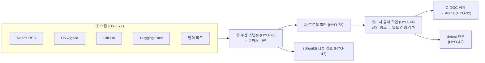

# 수집 파이프라인 설계 (M2 · DOC 파이프라인)

> 초안 v0 · 2026-10-02 · 상위 문서: `overview.md` (M2, 에픽 E9 HYO-69) · Linear HYO-70
> 관련: `retrieval-arena.md` §2(C-DOC) · `importance-policy.md` · `comparison-protocol.md` §1(역수입)
> 2026-10-01~02 논의와 출처 probe를 옮겼다. 결정은 모두 사용자가 했고 날짜를 붙였다. 미정 항목은 §11.

## 1. 왜 필요한가

### 1-1. C-DOC 정의에 정답이 들어갈 자리가 없었다

`retrieval-arena.md` §2의 C-DOC T0는 「실제 대상 기술 문서」, 즉 **이미 스택에 있는 기술**의 문서였다. 그런데 질의 유형 B·D·H(§3)의 정답은 **아직 쓰지 않는 기술**이다.

- B "벡터 색인 저장 공간을 줄이는 기술은?"
- D "regex PII 마스킹을 대체할 기존 기술은?"
- H "이 기술은 현재 구현을 대체하나 보완하나?"

쓰는 기술의 문서만 넣으면 이 질의들의 정답 문서는 처음부터 코퍼스 밖에 있다. C-DOC을 **어떻게 채우는지**가 설계에 없었다.

### 1-2. 스킬의 검색은 측정된 적이 없다

- 스킬에는 검색 코드가 없다. 모델이 Claude Code의 WebSearch·WebFetch를 직접 부른다. detect의 검색 지시는 한 문장이다(`SKILL.md` 흐름 2-2)
- 모델은 질의를 즉석에서 고쳐 쓴다. 과거 transcript에 조건 하나당 질의 변형이 여러 개 있다 (좁히기 → 넓히기 → 한국어)
- 그런데 eval의 `radar.py snapshot search`는 **질의를 무시하고** 고정 URL 목록을 돌려준다. 53/53 통과가 증명한 것은 판정 능력이지 검색 능력이 아니다
- WebFetch는 원문이 아니라 작은 모델의 요약을 돌려준다. 2026-10-01 ES 조사에서 그 요약이 RRF 등급을 틀리게 말했다(원본 파싱으로 정정)

### 1-3. 웹 검색으로 발견하는 방식의 한계

- **이름을 모르는 기술은 질의를 쓸 수 없다.** 질의 분해·최적화가 넓히는 범위는 「아는 것의 주변」까지다
- 웹 검색 API의 순위는 공급자의 것이다. 설계할 수도, 잴 수도 없다
- Google Custom Search JSON API는 신규 가입이 닫혔고 2027-01-01에 종료된다

그래서 **발견은 제한된 출처 풀의 흐름에서 하고, 웹 검색은 2단계(1차 출처 확인)로 내린다.** 질의는 사람이 쓰는 문장이 아니라 **프로필**(대상 repo 스택 · ADR의 문제 · 재검토 조건 · 사용자 관심사)이 맡는다. 문제의 종류가 검색에서 **필터링**으로 바뀐다.

## 2. 파이프라인



| 단계 | 하는 일 | 지표 |
|---|---|---|
| ① 수집 | 출처마다 어댑터가 공통 항목 형식으로 바꾼다 | 출처별 건수 · 요청 실패 · 429 |
| ② 스냅숏 | 매주 같은 요일·시각에 원자료를 얼린다. 이것이 C-DOC 코퍼스 버전이자 스킬·제품의 snapshot 입력 | 출처별 건수 추이 |
| ③ 필터 | 프로필로 「나한테 중요한가」를 거른다 | 닫힌 풀 안의 Recall@k · nDCG · **노이즈 비율** (pooling 판정) |
| ④ 1차 출처 | 후보마다 공식 문서·릴리스 노트·repo·모델 카드를 찾는다 | **후보 중 1차 출처를 찾은 비율** |
| (Should) 급증 | 주간 빈도 z-score, 기준선 4주 이상 | — |

### 2-1. importance-policy와의 관계

`importance-policy.md`의 detect 흐름은 **안에서 밖으로** 간다: C-CODE → 기술 단위 → 중요도 필터(기술 등급 × 변화 종류) → 질의 생성 → C-DOC 검색. 이 문서의 흐름은 **밖에서 안으로** 간다: 출처 흐름 → 프로필 필터 → C-DOC. 두 방향이 C-DOC에서 만난다.

- 스택에 이미 있는 기술의 소식(의존성 릴리스 등)에는 importance-policy의 두 축이 그대로 적용된다
- 스택에 없는 기술(새 모델·새 repo)은 importance-policy의 축 1(기술 등급)이 정의되지 않는다. 프로필 필터가 맡는다
- 두 필터를 어떻게 합칠지는 HYO-73에서 정한다

### 2-2. 프로필 (HYO-73, 2026-10-02 사용자 결정)

프로필은 필터의 **질의**다. 결과에는 항목마다 무엇 때문에 걸렸는지(`matched_by`)를 붙인다 — 설명하려고, 그리고 어느 요소가 쓸모 있는 항목을 만드는지 재려고.

| 재료 | 출처 | 입력 |
|---|---|---|
| 스택 | 대상 repo CLAUDE.md 「의존성 → component」·「외부 모델·서비스」 | 자동 |
| ADR의 문제 | ADR의 `technology`·`use`·「Context and Problem Statement」 | 자동 |
| 살아 있는 재검토 조건 | `radar.py list --in-scope` | 자동 |
| 관심사 · 제외 | 사용자 | `radar-profile.yaml` |

- **자동 재료는 저장하지 않고 실행마다 계산한다** (원본이 하나). 그 주에 계산된 프로필은 주간 스냅숏에 함께 남긴다 (재현)
- **원본 = ADR repo의 `radar-profile.yaml`** (`radar-targets.json` 옆, 환경 변수 `RADAR_PROFILE`). 스킬은 대화 → 미리보기 → 승인 → 파일 수정(R9와 같은 승인 규칙). 제품은 웹 폼 → 백엔드가 같은 파일에 직접 커밋. 형식 검사는 `radar.py validate`가 한다(규율 1). DB만 두면 스킬이 못 읽어 비교가 불공정해진다
- `version`을 올릴 때마다 스냅숏·eval이 `profile@vN`으로 참조한다
- **v1 (2026-10-06)**: 관심사 14개(high 3 — 하이브리드·희소 검색 · 임베딩·리랭커 · GraphRAG) + 전역 제외 1개. Claude 초안 12개에 사용자가 음성(STT·TTS)·선호 최적화(DPO·ORPO)를 더했다 (HYO-73 댓글, adr PR #3)

관심사 한 항목:

| 필드 | 구분 | 쓰임 |
|---|---|---|
| `topic` | 필수 | 표시 · 벡터 |
| `description` | 필수 | 벡터 검색의 주 재료 |
| `examples` | 권장 | 키워드 매칭 · LLM 판정의 정답 예시 |
| `not` | 권장 | 감점 · LLM 판정의 오답 예시 |
| `aliases` | 선택 | 키워드 검색 (영어). **쓸지 말지가 전략 변수** — 손으로 쓴 확장 대 SPLADE(학습된 확장) 대 질의 변환(LLM 확장)을 섞지 않으려고 |
| `priority` | 선택 | `high`·`normal`·`low` (기본 `normal`) |
| `relates_to` | 선택 | `adr:0004` · `repo:fineprint` |
| `why` | 선택 | 입력한 말 그대로. **변경 (2026-10-06, 사용자)**: 자동 → 선택 — 관심에 이유가 꼭 있을 필요는 없다 |
| `id` · `added` · `review_after` · `active` | 자동 (고칠 수 있음) | slug · 날짜 · 기본 `added`+28일에 「아직 관심 있나요?」 · 지우지 않고 끄기 |

```yaml
version: 1
interests:
  - id: multimodal
    topic: 멀티모달
    description: 이미지와 문서를 함께 이해하는 모델. OCR·문서 이해·표 추출 포함
    examples: [TeleOCR, Qwen3.8-VL, Cloudflare/clef]
    not: [이미지 생성, 영상 생성, 텍스트→이미지]
    aliases: [multimodal, VLM, vision-language, OCR]
    priority: normal
    relates_to: [repo:fineprint]
    why: 현재 내 관심사 내에 있고 확장 가능한 부분
    added: 2026-10-02
    review_after: 2026-10-30
    active: true
excludes:
  - topic: 이미지·영상 생성 도구          # 필수는 topic만. description·aliases 선택
    why: 스택·관심사 밖
    added: 2026-10-02
```

- **제외는 감점이다** — 관심사의 `not`(그 관심사에만)과 전역 `excludes`(전체) 모두. `matched_by`에 `exclude`로 남긴다. 4주 뒤 「감점된 것 중 원했던 게 있었나」를 보고 강제 제외로 바꿀지 정한다
- **`examples`는 eval에서 알려진 정답으로 따로 센다** — 적어 준 것을 찾는 건 필터 성능이 아니다 (규율 6과 같은 원칙)

매칭 방식 (사용자 가설, 2026-10-02): **하이브리드** — `description`은 벡터, `id`·`topic`·`examples`(·`aliases`)는 키워드. 둘이 서로 모자란 곳을 메워 종합적으로 낫다. 한국어 → 영어는 질의 변환으로 푼다. 보탠 조건:
- 질의 변환(LLM)은 **프로필 버전마다 한 번 번역해 저장**하고 그 저장본을 쓴다 (재현)
- 자르는 기준(몇 개 보여 줄지)은 **1~2주차 스냅숏(dev)에서 정하고 3주차부터(test) 고정**한다 (규율 7)
- 반대 가설: 항목이 짧은 출처(HF 모델 이름, Reddit·HN 제목)에서는 벡터가 흔들리고 키워드가 낫고, 초록이 있는 Daily Papers에서는 벡터가 낫다 — 출처마다 유리한 쪽이 다를 수 있다. RRF는 두 쪽을 같은 무게로 합쳐서, 한쪽이 아주 부정확한 출처에서는 키워드 단독보다 나빠질 수 있다
- **예측 (사용자, 2026-10-02 — 결과 0건)**: 하이브리드(키워드 + 벡터, RRF)가 키워드 단독·벡터 단독보다 낫고, 차이는 작다(「상호 보완에서 조금 더」). 전략 × 출처 예측 격자는 만들지 않는다 (사용자 결정). 비교할 전략 후보: 키워드(기준선) · 키워드 + `aliases` · 키워드 + 질의 변환 · SPLADE + 질의 변환 · 벡터(BGE-M3 dense) · 하이브리드

### 2-3. 두 레인 (importance-policy와의 결합, 2026-10-02 사용자 결정)

점수 하나로 합치지 않는다. 보여 주는 화면은 하나, 판정은 둘로 나눈다.

| 레인 | 무엇 | 판정 | 표시 |
|---|---|---|---|
| **A. 내 스택에 일어난 일** | 의존성 릴리스 · 모델 은퇴 · 벤더 변경 | `importance-policy.md` 관문 (등급 × 변화, 결정론적) | 정책대로 (5개 + `5/N`) |
| **B. 새로 볼 만한 것** | 새 모델 · repo · 글 · 논문 | 프로필 하이브리드 **점수** (관련도 · 커뮤니티 신호 · `priority` · 감점을 이 안에서 합친다) | 상위 k개 (k는 dev 주에 정한다) |

- 이유: 하나의 점수로 합치면 A의 ✅ 규칙(예: 호스팅 모델 은퇴는 무조건 남김)이 가중치 하나로 무력해진다 — 은퇴·보안 공지가 그 주의 화제 모델에 밀린다. 스크립트가 집행하는 규칙(규율 1)을 점수에 섞지 않는다. 등록된 정책(v1.3)도 건드리지 않고, 놓친 것이 어느 레인 탓인지 가를 수 있다
- 한 항목이 두 레인에 다 걸리면(예: 스택 기술의 새 메이저이면서 관심사에도 맞음) A에 두고 `matched_by`에 둘 다 남긴다

변경 (2026-10-19, 레인 B는 관심사로 거르기 때문에 관심사 밖의 화제를 인기와 상관없이 버린다 — W42 HN 인기 상위 8개 전부, HYO-127): **레인 C. 화제**를 더한다. 위 두 레인과 표는 그대로 둔다.

| 레인 | 무엇 | 판정 | 표시 |
|---|---|---|---|
| **C. 화제** | 분야를 가리지 않고 그 주에 인기 있던 소식 | 토픽으로 묶고(precision 우선) 출처 안 순위로 인기를 잰다. 관심사·스택을 보지 않는다 | 상위 k(잠정 10) — 절반은 여러 출처 토픽, 절반은 한 출처 토픽. 저장 · capture 버튼 |

- A·B와 점수를 합치지 않는다 (위와 같은 이유). 후보는 레인 B 항목 중 인기 신호가 있는 것 — 같은 항목이 B 순위와 C 토픽에 함께 나올 수 있다(판정이 다르다)
- 묶기 1단계 = 같은 링크 + 크로스포스트만 (사용자 결정 2026-10-16 · W42에서 링크 묶음은 전부 맞고 드문 낱말 매칭은 엉터리). 이름·임베딩 묶기는 손 묶음 정답지를 결과 보기 전에 등록한 뒤 (규율 7)
- 순위: 10/16에는 「출처 수 먼저, 그다음 인기」로 정했다. W42로 재 보니 여러 출처 토픽 31개가 상위를 다 차지해 HN 2,042점 Mistral Large 4가 35위였다 → 자리 나눔 (사용자 2026-10-19). k와 나눔 비율은 W41·W42(dev)에서 정하고 고정한다
- capture는 결정 질문이 있을 때만 — 화제를 전부 ADR로 넘기면 adr repo가 메모장이 된다. 쓸모 판정: 4주 실사용 뒤 저장·capture가 거의 0이면 접는다
- 구현: `pipeline/topics.py` (README 「레인 C 화제」)

변경 (2026-10-28, 사용자 결정 — 상위 k만 보이면 화제 계층 부모 제안(HYO-152)이 주 0~1개라 피드백 루프가 돌지 않는다, HYO-154): 표시에 **「더 보기」**를 더한다. 기본 표시(상위 k, 자리 나눔)는 그대로 둔다.
- 펼치면 상위 k 아래를 **파이프라인 파일 순위 그대로**(「보이지 않는 순위 — 측정용」 = 여러 출처 나머지 → 한 출처 나머지) k개씩 더 보인다. **최대 120** — 부모 제안 규칙을 오프라인에서 잰 범위(gold-w42 · gold-w43 상위 120)와 같다
- 근거 (응답 0건, 제안 수만 셈 — 백엔드 계산 그대로): 보이는 범위별 부모 제안 수 W41 1·1·1·1·3 / W42 1·2·3·4·6 / W43 1·1·3·5·5 / W44 0·3·4·4·5 (상위 10·20·30·50·120)
- 「쓸모 판정」(저장·capture 수)은 펼친 화제도 함께 센다. 펼친 화제에서 나온 것인지는 순위로 가를 수 있다

변경 (2026-11-04, 사용자 — HYO-170 가 · 나): **경보 그물**을 더한다. 레인 나누기와 위 세 표는 그대로 둔다. 레인 B 중 제목에 스택 이름(+ 런타임 · 도구 이름 Python · CPython · Node.js · Chromium · PyPI · npm · Docker · GitHub Actions · Claude Code · Codex)과 사고 · 종료 낱말(CVE · backdoor · malware · compromised · RCE · PSA · deprecat · retire · EOL · shut down …)이 **함께** 나오면 인기와 상관없이 **관문에도** 보낸다(레인 B 순위에도 그대로 남는다 — `pipeline/alarm.py`). 관문이 등급 × 변화로 정하고, 등급 파일에 없는 런타임 · 도구(Claude Code 등)라 판정 못 하면 버리지 않고 목록 「경보」 칸 · detect로(`security_alert` · community — detect가 공식 공지를 찾는다, R2). 같은 사고 글 여러 개는 관문이 붙인 기술로 묶어 하나만 detect. 「우리 스택 아님」: 사고 낱말 + 인기 높음(HN 100점 · Reddit 10위) + 그물 밖 상위 5건을 목록 맨 아래에 한 줄씩.
- 왜: W44에 우리 스택의 사고 4건이 수집되고도 레인 B 순위에만 있었다 — LiteLLM 1.107.0 PyPI 백도어(HN 596점 · Reddit 3, 1.107.0은 PyPI에만 있어 레인 A가 못 봤다) · http2shell · Broccoli2Shell(Node.js · Python RCE — 레인 A에 런타임 출처가 없다) · llama.cpp CVE PSA. 레인 B는 관심사 점수 순위라 detect에도 화면에도 이어져 있지 않다(HYO-167). 같은 주 PHP2Shell은 우리 스택이 아니라 안 올린 게 맞지만 「보고 넘겼다」가 보이지 않았다
- 오프라인(W41~W45 얼린 스냅숏, 모델 없이): 그물 주 2 · 1 · 0 · 8 · 5건, 위 사고 전부 걸림. 흔한 영어 낱말인 스택 이름(`requests`)은 제목에서 이름으로 보지 않는다(W43 「… in response to requests」). 낱말 · 문턱은 첫 값 — 바꾸면 여기에 변경으로
- 커뮤니티 출처는 늦다(HN 2일 지연 — §4-2). 주 그물은 공식 보안 채널(OSV · Python · Node.js 공지 — HYO-170 다, 수집기)이어야 하고 이 그물은 보조다

### 2-4. 주간 스냅숏 (HYO-72, 2026-10-06)

- **저장 위치 = 새 private data repo `hyos0415/radar-snapshots`** (사용자 결정 2026-10-06). 기각: decision-radar(나중에 공개한다 — Reddit·HN 본문을 재배포하게 되고 git 이력에서 빼기 어렵다) · ADR repo(설정은 필요 없지만 사람이 쓴 결정 기록과 스킬 배포 대상 사이에 매주 기계 커밋이 섞인다). 대가: 클라우드 skill v2(HYO-75)가 읽으려면 GitHub App과 routine sources에 이 repo를 붙여야 한다
- **코퍼스 버전 = `corpus@<ISO 주차>`** — 화요일 weekly 실행 시각(KST)의 주. 한 주 = weekly ∪ 지난 스냅숏 이후의 목요일 AWS 실행, 같은 id는 합친다. `manifest.json`에 실행·pool/vendors 버전·수집기 커밋·출처별 건수·항목 해시
- **first-seen 원장**으로 다시 나온 항목(통로 ②, HF trending 단골)에 `new: false`를 붙인다. 지우지 않는다(원칙 1) — 「새 것만」은 필터의 선택이다
- **벤더 페이지는 전문을 줄 단위로** 보관하고 지난 주와 비교해 `page-diff` 항목(더해진 줄 · 빠진 줄)을 만든다. 전에는 본문을 한 줄로 뭉개고 8,000자에서 잘라 비교가 불가능했다 (Anthropic 릴리스 노트 84,295자). 같은 날 20분 간격 두 번 받기에서 6개 페이지 모두 `unchanged` — 한 주 간격의 노이즈(날짜 표시 등)는 첫 몇 주에 본다
- 얼린 주는 고치지 않는다 (규율 7과 같은 원칙). 놓친 주는 다음 manifest의 `missing_weeks`
- 첫 스냅숏: 2026-10-06 16:00 예약 실행 = `corpus@2026-W41`. 10/2 시험 수집은 형식이 달라(페이지 한 줄·잘림) 넣지 않는다

## 3. 원칙

1. **수집은 넓게, 거르기는 뒤에서.** 수집 단계에서 자른 것은 출처에 따라 되돌릴 수 없다. 노이즈는 필터에서 걸러야 필터를 잴 수 있다 (importance-policy 헤드라인 = 노이즈 비율). 근거: flair는 글쓴이가 붙인 라벨이라 부정확하다(r/LocalLLaMA의 「llama.cpp prompt lookup 42배」는 Discussion에 있었다). AI 키워드 정규식은 `DeepGEMM-Ascend`·`VisionHOPE`를 놓쳤다
2. **세분화(flair·태스크)는 범위를 넓히는 데만 쓴다.** 상한(100개)을 넘거나, 전체 순위에 묻힌 영역을 꺼내는 용도다
3. **출처 단위로는 고른다.** 신호가 거의 없는 출처는 넣지 않는다. 출처가 늘면 요청보다 **사람의 판정 분량**이 는다 (pooling)
4. **커뮤니티는 신호, 근거는 1차 출처** (R2). Reddit·HN 글은 근거가 되지 않는다. GitHub repo와 HF 모델 카드는 그 자체가 1차 출처다
5. **공식 API·피드만 쓴다. 크롤링하지 않는다.** Reddit 약관과 robots.txt, 공개 예정인 레포. github.com/trending은 API가 없어서 쓰지 않는다
6. **출처가 끊기면 기능이 아니라 품질만 떨어지게.** 어댑터 인터페이스로 출처를 갈아 끼운다(예: Reddit RSS → 공식 API)

### 3-1. 되돌릴 수 있는가

| 출처 | 지난 기간을 다시 받을 수 있나 | 그래서 |
|---|---|---|
| Reddit RSS | **없다** (`t`는 굴러가는 기간) | 한 주를 놓치면 영구 손실. 매주 같은 시각에 수집한다 |
| HN Algolia | 있다 (날짜 범위 지정) | 기준선을 낮추면 지난 기간을 다시 받는다 |
| HF Daily Papers | 있다 (`date=`) | 같음 |
| HF trending | 없다 (그 순간의 순위) | 처음 본 날짜를 기록한다 |
| GitHub 검색 | 부분적 (생성일로 지정 가능, 스타 수는 현재값) | 스타 증가 속도는 매주 쌓아야 계산된다 |
| 벤더 페이지 | 없다 (현재 페이지만) | 주간 텍스트를 보관해 비교한다 |

## 4. 출처 풀 (확정, 2026-10-02)

모든 수치는 2026-10-02 probe 기준이다(§부록).

### 4-1. Reddit (RSS)

| 서브레딧 | 받는 것 | 이번 주 |
|---|---|---|
| r/LocalLLaMA | `top.rss?t=week&limit=100` + flair New Model · News · Resources | 100+ (New Model 31 · News 29 · Resources 60) |
| r/LLMDevs | top 100 + flair Tools · News · Resource | 100+ (Tools 62 · News 19 · Resource 100+) |
| r/LangChain · r/Rag · r/vectordatabase | top 100 (= 전부) | 55 · 65 · 20 |

- 제외 (사용자 결정): r/AI_Agents·r/mlops(기술보다 노하우), r/ClaudeAI·r/ClaudeCode(벤더 피드가 맡음 — 대가: Claude Code 회귀에 대한 사용자 반응, 질의 유형 G), r/MachineLearning(HF Papers와 겹침), r/LocalLLM·r/OpenAI(잡담), r/elasticsearch(주 2건)·r/Neo4j(0건)
- 제약: **요청 간격 60초**(8초면 429) → 주 약 11회, 약 11분. 피드에 점수·댓글 수가 없다(순위만). `category`는 flair가 아니라 서브레딧 이름. flair 검색은 부분 일치(`Resource`가 `Great Resource 🚀`까지 잡음) → **글 ID로 중복 제거**. `.json`은 403
- `t=week`는 주 초반 글이 유리하다(투표받을 시간이 길다). `t=day` 매일 수집과 비교는 운영하며 본다
- 공식 Data API는 2025-11부터 승인제(Responsible Builder Policy). 신청은 사용자 몫. RSS는 Reddit이 다음에 닫을 대상으로 거론된다
- **4주 뒤**: 세 작은 서브레딧은 필터를 통과한 글의 flair 분포를 보고 flair로 자를지 정한다

### 4-2. Hacker News (Algolia)

- `search_by_date`, `tags=story`, **points ≥ 25**, **2일 지연** — 매주 「2~9일 전에 올라온 글」을 받는다
- 2일 지연 이유: 최근 2일 글 1,000건 중 50점 이상은 42건이었다. 점수가 쌓이는 데 시간이 걸린다
- 점수 구간 (9~2일 전, 7일치): 200↑ 162 · 100~199 139 · 50~99 148 · 20~49 197 · 10~19 248건
- 20~49점에 스택 기술 글이 있었다(「Jev Based Code Review」 48, 「What if Jev spoke Arrow?」 45). 10~19점에는 「Anthropic classifiers prohibit kernel development」(18)
- 점수·댓글 수는 필터 특징으로 넘긴다. URL이 github.com이면 GitHub 통로와 repo 기준으로 중복 제거
- **4주 뒤**: 필터 통과 글의 점수 구간을 보고 기준선을 낮추거나(지난 기간 재수집) 올린다

### 4-3. GitHub

| 통로 | 질의 | 지금 | 요청 |
|---|---|---|---|
| ① 새로 뜬 것 | `created:>7일 전 stars:>=100` | 113 | 2 |
| ② 천천히 뜬 것 | `created:30일 전..7일 전 stars:>=500` | 246 (첫 실행만 몰아 받고 이후 repo ID 중복 제거) | 3 |
| 의존성 릴리스 | 스택 의존성의 `releases.atom` (조회 — 검색이 아니다) | — | 의존성 수 |

변경 (2026-10-08, 데스크톱 앱(Electron·React)이 생겨 CLAUDE.md 표의 npm 이름을 PyPI로 찾으면 엉뚱한 repo가 잡힘): 의존성 이름을 대상 repo의 `package.json`에서 직접 읽고 npm registry의 `repository`로 GitHub repo를 찾는다. CLAUDE.md 표의 `(npm, …)` 행은 건너뛴다. 수집 기준 `pool.yaml` version 1 → 2.

- 통로 ②가 필요한 이유: 7일 창만 보면 첫 주 30★ → 둘째 주 300★인 repo는 한 번도 잡히지 않는다. HYO-47(스타 증가 속도)이 생기면 대체 후보
- topic 필터 없음(상위 100 중 58개가 topic 없음) · 언어 필터 없음(`jevgrep`은 TypeScript) · 키워드 사전 컷 없음
- 한도: 검색 분당 30회, REST 시간당 5,000회 (확인)

### 4-4. Hugging Face

| 항목 | 받는 것 | 요청 |
|---|---|---|
| 전체 trending | `sort=trendingScore` 상위 100 | 1 |
| 태스크별 trending | 상위 20 × text-generation · feature-extraction · sentence-similarity · token-classification · text-classification · text-ranking · image-text-to-text | 7 |
| Daily Papers | `daily_papers?date=` 7일치 전부 (주 약 255편, 주말 0) | 7 |

- 태스크별이 필요한 이유: 전체 trending 상위 100에 임베딩 0 · NER 1 · reranker 1뿐이었다
- image-text-to-text(멀티모달)는 사용자 관심사이고 확장할 영역이라 넣었다 (사용자 결정)
- 모델 나이·trendingScore·upvote는 필터 특징. sentence-similarity trending에는 오래된 단골 모델(all-MiniLM, bge-m3)이 섞인다
- `sort=likes7d`는 trending과 같은 결과가 나왔다 — 무시되는 것으로 보인다 (미확인)

### 4-5. 벤더 피드 (혼합 방식)

- **어느 벤더를 볼지 = 규칙**: (대상 repo CLAUDE.md 「외부 모델·서비스」 표의 호스팅 서비스) ∪ (재검토 조건이 살아 있는 ADR의 기술). OSS는 GitHub 릴리스, 공개 모델은 HF가 맡는다
- **벤더마다 어느 경로를 볼지 = 손으로 관리하는 매핑 파일**. 규칙이 뽑은 벤더에 매핑이 없으면 「경로 없음」으로 알린다

| 벤더 | 근거 | 경로 |
|---|---|---|
| Anthropic | 레포 3개 | API 릴리스 노트 · 모델 지원 종료 페이지(페이지 비교) · claude-code `releases.atom` |
| OpenAI | ADR 0007·0008 · finance_verifier eval | API changelog · deprecations 페이지(페이지 비교) · openai-agents-python `releases.atom`. 뉴스 RSS는 마케팅 위주라 제외 |
| AWS Bedrock | ADR 0002·0003 | What's New RSS를 Bedrock으로 거름. 100건 ≈ 9일 분량이라 **주 2회** |
| Langfuse | finance_verifier | `releases.atom` · 변경 기록 페이지 |
| LangSmith · LangGraph | ADR 0009 · decision-radar | `releases.atom` |
| Gemini API | Arena 임베딩 변형 | 변경 기록 페이지(페이지 비교) |

- 제외 (사용자 결정): NVIDIA API(모델 페이지가 자바스크립트 렌더링이라 비교 불가) · 금감원 Finlife · 국가법령정보 DRF(데이터 의존성 — 바뀌면 fineprint 수집이 깨지며 레포에서 드러난다)
- **페이지 비교는 본문 텍스트로.** 같은 내용의 페이지도 원본 HTML 해시는 요청마다 달랐다
- 변경 (2026-11-04, 사용자 결정 — HYO-168 가): **changelog · release notes 페이지의 diff는 날짜 블록마다 항목 하나로 읽는다** (`pipeline/page_entries.py`). 얼린 스냅숏은 그대로 두고 파이프라인이 읽을 때 쪼갠다 — 지난 주에도 같은 코드가 걸린다. deprecations처럼 행마다 날짜가 있는 표는 쪼개지 않는다. 계기: 2026-W44 OpenAI changelog diff 하나에 「Oct 26 · Released GPT-6.1 Terra」와 「Oct 22 · gpt-6-luna Decisions API」가 섞여, 관문이 luna 줄로만 판정해(「가격·한도 변경」으로 남김) Terra는 아무도 보지 않았다. 확인(얼린 W44 · W45, 쪼갠 항목만 관문 gpt-6.1-sol에 다시 걸기, $0.05): Terra 블록은 제 항목이 되지만 관문은 「minor·patch」로 버린다(W45의 GPT-6 Rosalind 출시도 같다) — 이름 기반 관문으로는 새 모델을 못 남긴다. 새 모델 판정(HYO-168 나)이 따로 맡는다
- 규제 출처는 HYO-68(Could)로 따로 둔다 — 신호만, 판단은 사람

### 4-6. 공식 보안 채널 (변경 2026-11-04, 사용자 — HYO-170 다)

변경 (2026-11-04, 사용자 결정 — W44 우리 스택 사고가 레인 A 출처에 없었다): 출처 풀에 **공식 보안 채널**을 더한다. 위 다섯 출처와 레인 나누기는 그대로 두고, 레인 A 통로가 둘 늘어난다(`pipeline/lanes.py`). 수집 기준 `pool.yaml` version 2 → 3.

| 통로 | 받는 것 | 관문이 보는 기술 (`meta.dependency`) |
|---|---|---|
| `security-advisories` (OSV.dev) | 대상 repo manifest(requirements · pyproject · package.json — 관문 · basis와 같은 파서)의 PyPI · npm 이름을 **버전 없이** `POST /v1/querybatch`로 묻는다. 창(8일, 의존성 릴리스와 같다) 안에 **발행된** 공지 + 악성 패키지 기록(`MAL-`)은 창 안에 **수정된** 것도. 공지 하나 = 항목 하나 (같은 취약점의 별칭 GHSA · PYSEC은 하나로). 등급 파일에서 `retired`인 기술은 묻지 않는다 | 그 의존성 |
| `runtime-security:python` | `security-announce@python.org` 피드 (PSRT 공식 — CVE마다 한 글) | 본문에 CPython이 있으면 python, 아니면 없음(certifi · pip 공지 — 제목 이름으로 관문이 찾는다) — 아래 변경: python/cpython 링크도 |
| `runtime-security:nodejs` | `nodejs.org/en/feed/vulnerability.xml` (보안 릴리스 글 — 피드 본문이 비어 창 안 글만 페이지를 받는다) | electron (우리 Node는 Electron 안 · 등급 파일에 node.js 없음) |

- 왜: W44에 LiteLLM 1.107.0 백도어(PyPI에만 — GitHub releases를 보는 레인 A가 못 봤다) · http2shell · Broccoli2Shell(Node.js · Python RCE — 레인 A에 런타임 출처가 없다)이 레인 B 커뮤니티 글로만 왔다. 경보 그물(§2-3 변경 11/4)은 커뮤니티에 기대는 보조 그물이고, 이쪽이 주 그물이다. 공식 근거라 R2를 통과한다 (detect 입력 `security_advisory` · `official_doc`)
- 버전 없이 묻는 이유: basis의 「우리 버전」은 대부분 spec 하한(`>=`)이라 깔린 버전이 아니고, 우리가 그 버전이 아니면 공급망 사고(1.107.0)를 못 잡는다. 우리 버전에 해당하는지는 관문 · detect 몫
- 날짜 규칙 근거 (2026-11-04 실측): LiteLLM 백도어 기록 `MAL-2026-2144`는 **3/24 발행**(1.82.7 건) 기록에 **10/29 1.107.0이 덧붙은** 것이다 — 발행일만 보면 놓친다. 일반 GHSA 옛 공지도 다시 고쳐지지만 내용은 그대로라 뺀다(W45: 2023년 langchain SQLi 등 4건). 수정으로 들어온 MAL은 id에 수정일을 붙여 새 항목으로 — 같은 기록에 버전이 또 붙으면 다시 올라온다
- 주별 OSV 공지 수 (우리 의존성 80개 = PyPI 40 · npm 40, 오늘 API로 지난 주를 다시 물은 값 — 지난 주의 수정일은 그 뒤 수정에 덮였을 수 있다): 발행 W41 8 · W42 0 · W43 1 · W44 15(electron 8 · vite 6) · W45 5. 관문(유료) 호출이 주 0~15회 는다. 기술마다 top-3 목록 상한(HYO-168)이 양을 누른다
- 공식 채널도 늦을 수 있다: 1.107.0 PyPI 업로드 10/21 → OSV 기록 10/29(8일). 그 주는 HN(W44)이 먼저였다 — 경보 그물을 남겨 두는 이유
- Chromium 보안 공지는 따로 받지 않는다 (제안 — Chrome Releases는 주 여러 건이고, Electron 릴리스 노트가 Chromium CVE 백포트를 적고 Electron 자체 공지는 OSV npm `electron`으로 온다)
- 실패 규칙은 다른 출처와 같다: 죽은 통로는 `run.json` `sources.security.failed`에 남고 나머지는 계속. 첫 적용 W46(11/10) — `docs/decisions/real-use-changes.md`

변경 (2026-11-04, 사용자 — 리뷰 나안): 위 「우리 버전에 해당하는지는 관문 · detect 몫」을 정한다. 수집은 그대로 버전 없이 받고, 공지마다 **우리 버전으로 다시 물어** `meta.affects_ours`(해당 · 해당 없음 · 모름)를 단다(`security.mark_ours` — 관문 · scope와 같은 버전 읽기, 범위는 하한). 관문은 판정을 바꾸지 않고, 「항상」 칸에서 **해당 없는 공지는 목록에만**(악성 기록 `MAL-`은 `^` 범위가 다음 설치에 끌어올 수 있어 버전과 상관없이 · 모르면 안전 쪽으로 detect), detect로는 **패키지마다 1건**(악성 기록이 대표)으로 접고 접힌 해당분의 제목 · 링크를 대표 입력에 붙인다 (`policy.quiet_advisory` · `fold_key`). Python 공지는 「CPython」 낱말이 없어도 `github.com/python/cpython` 링크가 있으면 python으로.
- 왜: 보안은 모든 등급에서 남기고 「항상」 칸은 top-3 상한 밖이라(위 「상한이 양을 누른다」는 틀렸다), 공지 하나가 detect 1건이 된다. W44 창 다시 묻기: OSV 20건 중 우리 버전 해당 7(vite 5 · langgraph · langgraph-checkpoint-sqlite) · 해당 없음 13(electron 9 — 우리 45.0.0은 45 알파에서 이미 고침 · mcp 3 — 2.2.0에서 고침 · vite 6.x 1). 우리 버전에서 이미 고쳐진 공지는 결정할 게 없다. CVE-2026-115557(ssl 인증서 거부 목록)은 「Python has added …」로 시작해 CPython 낱말이 없었다
- 결과 (W44 · W45 창, 모델 없이): OSV detect 20 → 3 · 5 → 1. 범위 하한으로 물으니 실제 깔린 게 더 새 버전이면 「해당」으로 나올 수 있다 — 안전 쪽 오판

## 5. 측정

| 무엇을 | 어떻게 | 언제 |
|---|---|---|
| 필터 품질 | 닫힌 풀(주간 스냅숏) 안에서 pooling 판정 → Recall@k · nDCG · 노이즈 비율. 판정은 사용자가 시스템이 보여 준 것을 **알아보기**만 한다 | 필터 구현 후 |
| 1차 출처 확인 | 후보 중 1차 출처를 찾은 비율 | HYO-74 |
| 출처 기여 | 필터 통과 항목이 어느 출처·flair·점수 구간에서 나왔나. Reddit의 고유 기여(HN·GitHub에 없던 비율) | 4주 운영 후 |
| 출처 풀 효과 | `skill@v1`(웹 검색) ↔ `skill@v2`(같은 스냅숏을 읽는 detect) 짝 eval | HYO-75 |

쓰지 않기로 한 측정 (사용자 판단, 2026-10-01): known-item 세트(메이저 기술은 둘 다 천장), oracle 대조(이미 53/53이라 변별력 없음), 백테스트(검색 지표가 아니라 결과 지표로의 우회).

## 6. 스킬과의 관계

`comparison-protocol.md` §1 역수입 적용(2026-10-02): 실사용 기준선(10/5~11/1)은 `skill@v1` 그대로 돈다(detect = 웹 검색). 수집기가 완성되면 detect가 같은 스냅숏을 읽는 `skill@v2`를 만들고 v1 ↔ v2 짝 eval을 따로 한다 (HYO-75). 제품(11/2~)과 `skill@v1`의 실사용 차이에는 출처 풀 효과가 섞여 있다 — 판정문에 적는다.

## 7. Elasticsearch 등급 (overview Q4 · Arena A7의 답)

self-managed 구독 표(elastic.co/subscriptions, 2026-10-01 원본 파싱):

| Arena가 쓰는 곳 | 기능 | 등급 |
|---|---|---|
| S2 BM25 · k1·b | Relevance scoring · Analyzers | 무료 (오픈소스 포함) |
| S2 한국어 | `analysis-nori` 플러그인 | 무료. 이미지에 없다 — `elasticsearch-plugin install analysis-nori` |
| S4 · 임베딩 API 변형 | Vector field · Vector search · kNN retriever · 필터 ANN | 무료 (Basic) |
| S5a · S5b fusion | RRF · linear retriever | **Enterprise** → `ranx` + **직접 구현한 RRF**, 둘을 대조 (사용자 결정) |
| (안 씀) | ELSER · Inference API · Elastic Rerank · Rank Vectors · Learning to Rank | Platinum(기존 고객만) · Enterprise |

- 구독하지 않는다 (사용자 결정). 기업이 말하는 「ES 깊이」는 대부분 Basic 범위(분석기·relevance·HNSW·운영)다
- **trial 함정**: `start-local`은 30일 trial로 띄운다. compose에 `xpack.license.self_generated.type=basic`을 명시해 유료 기능 의존이 오늘 실패하게 한다
- **dense_vector 기본값이 라이선스·버전에 따라 바뀐다**: 9.4+는 「라이선스가 허락하면 `bbq_disk`(Enterprise)」, 9.1+는 384차원 이상이면 `bbq_hnsw`. S4는 `index_options`를 명시해야 한다 (사용자 결정 대기 — `S4.leann` 비교와 얽힌다)
- 9.2+는 벡터를 `_source`에서 기본 제외한다(`index.mapping.exclude_source_vectors`) — 색인 크기 측정 경계에 영향, 고정할 설정
- 최신 9.5.4 (2026-10-01). 이미지 버전을 고정한다
- **실측 (2026-10-02, `infra/smoke.py` — ES 9.5.4 Basic, Windows Docker)**: 위 등급표대로 되는 것은 다 되고(nori · BM25 k1·b · `hnsw`·`int8_hnsw`·`bbq_hnsw`·`*_flat` 색인과 kNN), RRF retriever는 `security_exception: current license is non-compliant for [Reciprocal Rank Fusion (RRF)]`로 막힌다. `index_options`를 적지 않으면 1024차원에서 **`bbq_hnsw`**가 걸린다. **`bbq_disk`는 매핑 생성은 통과하고 문서를 넣을 때 403**이 난다 — 빈 인덱스 검색은 200 + 빈 결과라, bulk 오류를 보지 않는 코드는 조용히 빈 색인을 만든다 (`infra/README.md`)
- OpenSearch는 2.19부터 RRF가 무료지만 전환하지 않는다 — 엔진 비교는 Won't, 이 문제는 직접 구현으로 풀린다

## 8. 운영

| 항목 | 값 |
|---|---|
| 주기 | **화요일 16:00 KST** 주 1회 + AWS What's New만 **목요일 16:00** 한 번 더 (D4, 사용자 결정 2026-10-02 — 월·금은 연휴로 쉴 수 있다) |
| 요청 | Reddit 약 11 · GitHub 5 + 의존성 수 · HN 1~2 · HF 15 · 벤더 10여 |
| 실행 위치 | **로컬 — 지금은 교육장 Windows PC, 나중에 M1(외장 SSD)으로 이관** (D3, 사용자 결정 2026-10-02). 작업 스케줄러 `collector/schedule_windows.ps1`, 로그온 중에만, 놓친 시각은 다음에 켜질 때 바로 실행(StartWhenAvailable). 내 IP라 Reddit 차단 위험이 없다. 기각한 안: GitHub Actions·cloud routine·Lightsail(데이터센터 IP라 Reddit 위험은 같고, Lightsail은 서버 관리가 붙는다 — 제품 웹을 띄울 E6 때 다시 본다) · Airflow(상시 서버가 필요해 규모에 비해 무겁다 — 학습용 Could) |
| 스냅숏 | weekly 실행 직후 `collector.snapshot freeze --push` → `hyos0415/radar-snapshots` (§2-4) |
| 놓친 주 | PC가 꺼져 있어 못 돈 주는 Reddit·HF trending·벤더 페이지가 영구 손실이다(§3-1). `run.json`의 시각으로 드러난다. 월요일 routine은 지난 화요일 스냅숏(6일 전)을 읽는다 |
| 4주 뒤 다시 볼 것 | Reddit 작은 서브레딧의 flair 컷 · HN 기준선 · Reddit 고유 기여 · `t=week` 대 `t=day` |

## 9. 기각한 안

| 안 | 이유 |
|---|---|
| 웹 검색 API로 1차 발견 | 이름 모르는 기술을 못 찾고, 순위가 블랙박스다. 스킬이 이미 하는 방식이라 기준선과 같아진다 |
| 크롤링 (Reddit HTML, github.com/trending) | 약관·robots.txt. 공개 레포의 감점 요인 |
| 수집 단계 flair·키워드·언어 컷 | 되돌릴 수 없고(일부 출처), 라벨이 부정확하며, 필터를 잴 수 없게 된다 |
| ES Enterprise 구독 · OpenSearch 전환 | §7 |

## 10. 바뀐 문서

- `retrieval-arena.md` §2 C-DOC: 변경 — 이 문서의 주간 스냅숏 + 1차 출처에서 채운다
- `overview.md` §9: 수집 기본 Should → Must · Q4 해결 · §11 E9
- `retrieval-arena.md` §10 A7: 해결 (§7)

## 11. 열린 질문

| # | 질문 | 누가 |
|---|---|---|
| ~~D1~~ | ~~프로필 정의 · importance-policy와의 결합 · 전략 비교 사전 등록~~ → §2-2 프로필 · §2-3 두 레인 · 예측은 한 줄만(격자 없음) (2026-10-02) | 해결 |
| ~~D2~~ | ~~S4 `index_options`~~ → `hnsw` (float) · Should 변형 `S4.int8`·`S4.bbq` · dev 진단 `flat` 계열 (`retrieval-arena.md` §6 변경, 2026-10-02) | 해결 |
| ~~D3~~ | ~~수집기를 어디서 돌리나~~ → 로컬 Windows PC, 나중에 M1 (§8) | 해결 (2026-10-02) |
| ~~D4~~ | ~~수집 요일·시각~~ → 화 16:00 + AWS 목 16:00 (§8) | 해결 (2026-10-02) |
| D5 | Reddit 공식 API 신청 | 사용자 |
| D6 | C-DOC 규모 티어(T1·T2)를 스냅숏 누적 주 수로 다시 정의할지 | HYO-32 착수 시 |
| ~~D7~~ | ~~스냅숏을 어디에 두나~~ → 새 private data repo (§2-4) | 해결 (2026-10-06) |

## 부록: probe 기록

2026-10-01~02, 스크립트는 세션 scratchpad에서 돌렸고 레포에는 없다 (결과 수치만 위에 옮겼다).

- Reddit: r/LocalLLaMA `top.rss?t=week` 25건(기본) · `limit=100` 100건 · `t=day&limit=100` 45건 · `new.rss?limit=100` 약 41시간 분량 · 13개 서브레딧 주간 활동량 · flair 16종 존재 확인
- HN: 주간 스토리 7,135 · 점수 구간 분포 · AI 제목 비율
- GitHub: 스타 기준 20·50·100·200·500 · 30일 창 · 언어 필터
- HF: trending 500 · 태스크 7개 · Daily Papers 7일
- 벤더: RSS·Atom·변경 기록 페이지 17곳 상태
