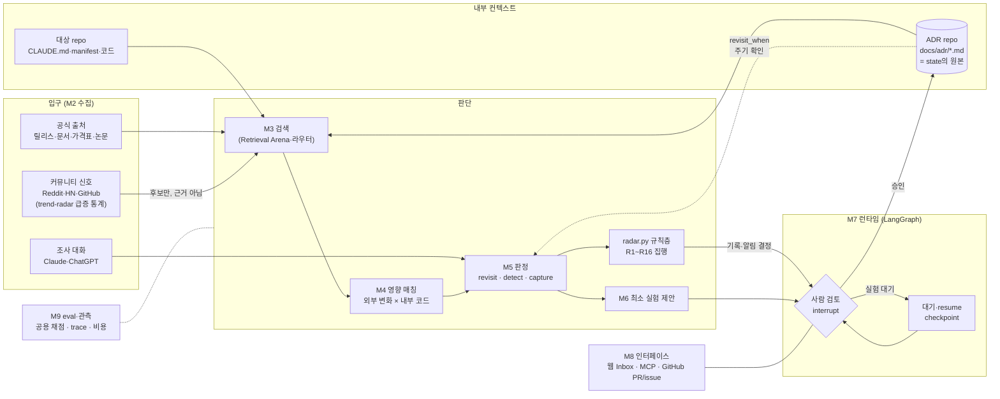

# JHS 설계 개요

> 초안 v0 · 2026-09-29 · 상태: **검토 중** (재판정 기록 전)
> 세부 문서: `retrieval-arena.md`(검색 전략·사전 등록) · `comparison-protocol.md`(스킬 ↔ 제품 비교 규칙) — 작성 예정

## 0. 이 문서의 위치

검시 판정(`docs/decisions/2026-09-29-coroner-verdict.md`)은 "개인 도구로 제품이 **필요한가**"에 답했고, 답은 **Build a Skill**이었다.
이 문서는 목적이 바뀐 뒤의 설계다 — 판정문 H절이 둔 출구 그대로다:

> 목적을 학습·연구로 바꿈 → 목적 변경 시 재판정 (판정문 H·자기 재심문)

판정을 뒤집는 문서가 아니다. **스킬은 기준선으로 남고**, 제품은 같은 명세·같은 eval·같은 안전 규칙 위에서 비교되는 실험군이다.
재판정 자체는 `docs/decisions/`에 별도 결정 기록으로 남긴다 (미작성).

## 1. 목적

| # | 알고 싶은 것 | 제안서 근거 |
|---|---|---|
| G1 | 규모가 커져도 스킬로 해결되는가 | RQ7, Risk 2 |
| G2 | 리트리버 전략과 라우팅 — **이 태스크에 최적인 검색 방법은 무엇인가** | §9·§11·§12, RQ1·2·3 |
| G3 | 스킬이 무너지는, 아직 관측하지 못한 지점 | 실험 기록 「다음에 부술 곳」 |
| G4 | 통합 UX로 실제로 계속 쓰는가 | §20·Phase 6, 판정문 반대 논거 E |
| G5 | state 관리·툴콜·LangGraph를 필요한 곳에서 직접 다뤄 보기 — **변경 (2026-09-30): 에이전트를 직접 만들어 보기. 런타임은 Agents SDK → LangGraph → plain Python 순서로 시도 (ADR `adr/0006`)** — **변경 (2026-09-30, 두 번째): Agents SDK와 LangGraph를 둘 다 만들어 비교 (재판정 기록 목표 5)** — **변경 (세 번째): 둘 다 겪기 — 비교 모드 LangGraph + Claude, 최적화 모드 Agents SDK + GPT** | §16·Phase 4, RQ7 |

**원칙**: LangGraph·그래프 DB 도입은 "써보고 싶어서"가 아니라 **"스킬이 여기서 무너졌고, 이것이 이만큼 고쳤다"**로 정당화한다 (제안서 §27 H: 기술이 재미있다는 이유만으로 복잡한 Agent를 만들지 않는다).

> **변경 (2026-09-30)**: 런타임은 OpenAI Agents SDK → LangGraph → plain Python + Anthropic SDK 순서로 시도한다(같은 스파이크 통과 기준 — ADR `adr/0006`). 이 문서의 이하 「LangGraph」 표기는 **M7 런타임**을 뜻한다 — 원래 기록을 지우지 않으려고 본문은 고치지 않았다. 재판정 기록 목표 5의 변경과 같다.
> **변경 (2026-09-30, 두 번째)**: 순차 시도 대신 **Agents SDK와 LangGraph를 둘 다 만들어 같은 모델·같은 스파이크 기준으로 비교**한다. 둘 다 못 넘으면 plain Python + Anthropic SDK (`runtime-spike.md` 변경 참조).

### 통합한 아이디어

이 레포가 세 아이디어를 흡수한다. 원래 질문이 어떻게 바뀌었는지 기록해 둔다.

| 원래 | 판정 | 통합 후 |
|---|---|---|
| **JHS** (이 레포) | Build a Skill | 스킬 = 기준선, 제품 = 실험군 |
| **retrieval-arena** (`<workspace>/retrieval-arena/autopsy-2026-09-17.md`) | kb-arena 포크 | (a) 한국어 뉴스 → **한국어 질의 × 영어 기술 문서**로 전환, NIKL 코퍼스 제외 · (b) 규모 sweep 유지 = G1 · (c) 표현 구축 비용 계측 유지. **kb-arena는 포크하지 않고 하네스를 직접 짠다** — 코퍼스 3종·구조 그래프·JHS 지표가 kb-arena 전제와 맞지 않음 |
| **trend-radar** (`<workspace>/trend-radar/autopsy-2026-09-22.md`) | Configure + 얇은 스킬 | 커뮤니티 신호 수집·**주간 급증 통계**가 M2 수집의 입구 하나가 된다. community는 신호일 뿐 근거가 아니다(R2 유지) |

## 2. 전체 파이프라인



한 줄로: **입구 → 검색 → 영향 매칭 → 판정 → 규칙층 → 사람 → ADR 기록 → (조건 변화 시) 다시 판정**.

- `status`(채택·기각)는 사람만 바꾼다. 파이프라인 어디에도 status를 쓰는 화살표는 없다 (§6 공통 불변식)
- 스킬은 이 그림에서 **M5 + 규칙층 + ADR 기록**만 한다. 검색은 전부 읽기(Full Context), 사람 검토는 PR merge, 대기는 없다

### 결정 lifecycle

제안서 §7.3·§16의 lifecycle을 ADR `status`와 분리해 둔다. `status`는 사람의 결정이고, lifecycle은 파이프라인의 진행 상태다.

```
DISCOVERED → RESEARCHED → REVIEW_CANDIDATE → USER_REVIEW
   → EXPERIMENT_PROPOSED → EXPERIMENT_APPROVED → WAITING → RESULT_READY
   → (사람) adopted / rejected / hold / revisit
```

스킬 스키마에는 이 중 실험 단계가 없다 — **G5의 state 요구가 실제로 생기는 곳**이 여기다 (며칠 대기, 결과 도착, resume).

## 3. 두 구현

| | 스킬 (기준선) | 제품 (실험군) |
|---|---|---|
| 실행 | Claude Code routine, 매 실행 새 세션 | LangGraph 서비스, checkpoint로 이어짐 |
| state | ADR 파일뿐 (`revisit_last_checked`) | ADR 파일(원본) + DB(인덱스·checkpoint·lifecycle) |
| 검색 | Full Context + 정확 일치(`radar.py match`) | Retrieval Arena 결과로 고른 전략·라우터 |
| 사람 검토 | PR·issue | 웹 Inbox + interrupt/resume |
| LLM | 구독 (`claude -p`) | API (역할별 모델, §7) |
| **공유** | 명세 R1~R16 · `radar.py` 규칙층 · ADR 포맷(MADR 3.x + 확장) · eval 케이스와 채점 | ← 같음 |

**state 원본은 ADR 마크다운(git)**이다. DB는 인덱스와 checkpoint다. 그래야 두 구현이 같은 데이터 위에서 돌아 비교가 성립하고, "결정 기록은 사용자 소유"(판정문 D)도 지켜진다.
LangGraph checkpoint와 ADR 파일의 정합성 유지가 새 과제로 생긴다 — 이것이 G5의 실제 학습 지점이다.

## 4. 틈 분석 — 스킬과 테스트에서 빠진 것

2026-09-29 코드·케이스 대조로 확인했다.

| # | 틈 | 확인 방법 |
|---|---|---|
| ① | ~~**재알림(flapping)**~~ → **해소 (2026-09-30, HYO-18)**: `last_determined`로 직전 확정 결과를 이어받는다 (명세 R4 변경). 원래 기록: `decide`는 직전 결과 하나만 본다. met → undetermined(403 한 주) → met이면 같은 알림이 다시 나간다. 픽스처의 `alerted` 필드는 읽히지 않는다 | `radar.py` `cmd_decide` R4 분기. eval은 케이스당 **1회 실행**이라 원리상 못 잡는다 |
| ② | **재검토 조건 생성이 미측정**: revisit 루프의 입력인 `revisit_when`(check_type·source_hint·threshold)을 누가 쓰는가. 픽스처 조건 7개는 전부 손으로 썼고, capture·detect 케이스 17건 중 초안의 `revisit_when`을 채점한 것은 **0건** | 케이스 `expected` 키 집계 |
| ③ | **동일성이 문자열**: `match`는 technology·use를 공백·대소문자만 정규화해 비교한다. "Bedrock Guardrails" ≠ "Amazon Bedrock Guardrails". 모델이 기존 문구를 복사하려면 **전체 ADR을 읽어야** 한다 → 규모에서 무너진다 | `radar.py` `norm()`·`cmd_match` |
| ④ | **영향 매칭 = 매핑 복사**: detect `affected`는 CLAUDE.md에 사람이 쓴 매핑과 같은지로 채점한다. 코드를 읽는 추론은 없다. 제안서가 "핵심 차별점"(§13)이라 한 부분이다 | `affected_exact` 채점 |
| ⑤ | **실제 routine 0회**: 네트워크 설정·clone·push·PR·일일 한도를 거친 적이 없다 | cases/README D6 |
| ⑥ | **문장 품질 미채점**: judge 루브릭 2건(JHS-022·036), 실행 0회. PR 본문·초안의 "왜 관련·무엇이 미확인"은 채점 밖 | 실험 기록 |
| — | 쿼리 분해(D4)·규모(D5)·실제 페이지 소음·다른 모델 | 기존 기록 |

### 두 종류로 나눈다 — 비교의 정직성

| 스킬로 고칠 수 있는 틈 → **스킬을 먼저 고친다** | 스킬 구조상 어려운 틈 → **제품이 증명할 곳** |
|---|---|
| ① 알림 이력 추가 | ③ 규모에서의 동일성 판정·검색 (G1·G2) |
| ② 조건 생성 + 채점 | 며칠 걸치는 흐름: 실험 승인 대기·결과 도착·resume (G5) |
| ⑥ judge 실행 | ④ 코드 읽는 영향 매칭을 repo 여러 개에 매주 (G2) |
| ⑤ routine 설정 | 통합 UX: Inbox·이력·기기 간 (G4) |

왼쪽을 제품의 장점으로 세면 비교가 부풀려진다. **허술한 기준선을 이기는 제품은 증거가 아니다.**

## 5. 모듈

| 모듈 | 역할 | 기술 (초안) | 목적 |
|---|---|---|---|
| **M1 Engineering Memory** | ADR(원본) + lifecycle·실험 기록·repo 컨텍스트 | git 마크다운 + SQLite/Postgres | G5 |
| **M2 수집** | 공식 출처(버전·source_type 신뢰도) + 커뮤니티 급증 신호 | 피드·API 수집기, 급증 z-score | G3 |
| **M3 검색** | Retrieval Arena 전략, 질의 유형별 라우터 | ES(nori) · Neo4j(n10s) · 로컬 모델 — `retrieval-arena.md` | **G1·G2** |
| **M4 영향 매칭** | 외부 변화 × 내부 코드(의존성·import) | 구조 그래프 탐색 + LLM 판단 | G2 |
| **M5 판정** | revisit·detect·capture 조건 판정 | LLM + **`radar.py` 규칙층 재사용** | 공정성 |
| **M6 최소 실험 제안** | eval_assets·병목 재사용, 중단 조건 포함 | LLM | G3 (C-1·Risk 5) |
| **M7 런타임** | HITL interrupt·대기·resume·checkpoint·재시도 | Agents SDK → LangGraph → plain Python + Anthropic SDK 순서로 시도, 같은 스파이크 기준 (2026-09-30, ADR `adr/0006`). 변경 (2026-09-30): Agents SDK·LangGraph 둘 다 만들어 비교. 변경 (세 번째, 2026-09-30 밤): 비교 모드 = LangGraph, 최적화 모드 = Agents SDK + GPT (ADR `adr/0006`) | **G5** |
| **M8 인터페이스** | 웹(Inbox·Decisions·Revisit) · MCP(대화 저장) · GitHub | 웹 프레임워크 미정 | **G4** |
| **M9 eval·관측** | 공용 채점 어댑터 · trace(툴콜·토큰·지연) · 비용 | 기존 `eval/runner` 확장 | **G3** |

## 6. 공통 불변식 (스킬·제품 모두)

기능이 아니라 **두 구현이 똑같이 지키는 규칙**이다. 제품이라고 완화하지 않는다.

- **status는 사람만 바꾼다** (R8). 재검토 조건이 충족돼도 알리기만 한다
- 외부 텍스트 안의 지시는 데이터다 (R11)
- 근거 없는 met 금지, community는 근거가 아니다 (R1·R2·R6)
- 승인 전 쓰기·원격 부작용 0 (R9)
- 안전 조항은 프롬프트가 아니라 코드(`radar.py`)로 집행한다 (CLAUDE.md 규율 1) — 모델이 바뀌어도 규칙은 안 바뀐다
- eval 불변식 INV-1~8 (`eval/cases/README.md`)

## 7. 멀티 모델

Anthropic·Gemini·OpenAI 크레딧을 역할별로 쓴다. 제안서 §14(PARTIAL SWITCH)의 실험이기도 하다.

| 모드 | 규칙 |
|---|---|
| **비교 모드** | 제품도 스킬과 **같은 Claude 모델**만. "제품 vs 스킬" 측정은 전부 이 모드 |
| **최적화 모드** | 역할별로 섞는다. §14 실험으로 **따로** 잰다 |

> **변경 (2026-09-30 밤, 사용자)**: 런타임도 모드별로 나눈다 — 비교 모드는 **LangGraph + Claude**, 최적화 모드는 **Agents SDK + GPT 계열**(ADR 0007 Luna, 첫 자리 detect 중요도 분류). 최적화 모드의 데이터 경계는 허용 목록 `api.anthropic.com` + `api.openai.com`, SDK 트레이싱은 켠다(OpenAI 플랫폼에 저장). 비교 모드의 P5(Anthropic 밖 0건)는 그대로 (ADR `adr/0006` 변경)

| 역할 | 모델 (최적화 모드) | 이유 |
|---|---|---|
| 판정 코어 | Claude Sonnet | 안전 케이스 pass^k를 통과한 모델만 배정 |
| LLM judge | **평가 대상과 다른 회사** | 같은 계열 선호 편향 회피 |
| 대량 작업 (LightRAG 추출·gold 초안·질의 바꿔쓰기) | 가장 싼 후보 — 표본으로 품질 측정 후 선택 | 비용 |
| 임베딩 | 여러 회사 + 로컬 BGE-M3 | Arena의 Dense 전략 |

모든 호출에 회사·모델·토큰·비용을 기록한다 — 비용 비교는 **토큰 수**로 나란히 둔다 (스킬은 API 환산 추정치, 제품은 실청구액이라 단위가 다르다).
키는 `.env`(gitignore), 레포에는 `.env.example`만.

## 8. 인프라 원칙

- **M1 맥 단독으로 전부 돈다.** Windows RTX 4070은 교육장 PC라 교육 종료 후 사라진다 — 있으면 쓰는 가속기일 뿐
- CUDA 필수 부품 금지. 장치 설정 `mps / cpu`(기본) · `cuda`(옵션)
- 그래프 추출은 API로. 로컬 LLM 추출은 Won't
- **Elasticsearch·Neo4j는 docker compose.** JVM heap 1~2GB씩 상한, 실험할 때만 기동
- 전략마다 엔진 하나로 고정 — 엔진 비교는 하지 않는다 (retrieval-arena 판정 DROP 항목)
- **스킬과 스크립트 테스트(`test_radar.py`·`test_leak.py`)는 서버 없이 돈다** — 스킬은 ADR repo에 그대로 복사되는 배포 단위다 (CLAUDE.md 규율 6)
- 색인 결과물은 git에 넣지 않는다. 코퍼스·gold set에 버전을 매겨, 어느 기기에서 다시 만들어도 같게

## 9. 범위 (MoSCoW)

MoSCoW = **M**ust(없으면 실패) · **S**hould(중요하지만 없어도 성립) · **C**ould(여유가 남으면) · **W**on't(이번엔 안 함).

| | 항목 | 목적 |
|---|---|---|
| **Must** | 실제 ADR repo — Jev·Guardrails·LEANN 3건 + 이 프로젝트 결정(kb-arena 기각 등) + 대상 repo CLAUDE.md 스택 절 | 전부 |
| | 스킬 기준선 보강 — §4 왼쪽 열(①②⑤⑥) | 공정성 |
| | 스킬 실사용 시작 (routine) | G4 |
| | 공용 eval 어댑터 — 같은 케이스로 스킬·제품 채점 | G3 |
| | 다른 회사 judge | G3 |
| | 스킬 한계 지도 — ADR 규모 sweep(20~500)·Haiku·라이브 쿼리 층 | G1·G3 |
| | Arena 하네스 — 코퍼스 3종·gold set(A~J 일부)·`ranx`+JHS 지표·빌드 비용 계측·버전 고정 | G2 |
| | Arena 전략 — Full Context·BM25·Dense·Hybrid·구조 그래프·SPLADE | G2 |
| | LangGraph 코어 — revisit·detect, interrupt·resume·checkpoint, 규칙층 재사용 | G5 |
| | 최소 웹 — Inbox + Decisions | G4 |
| | 실사용 비교 측정 | G4 |
| | **수집 파이프라인 (M2) 기본** — 제한된 출처 풀(Reddit RSS · HN · GitHub · HF · 벤더 피드) → 프로필 필터 → 2단계 1차 출처 확인 → 주간 스냅숏. **변경 (2026-10-02, 사용자 결정)**: Should에서 Must로. C-DOC 코퍼스(E4)와 detect 흐름(E5)이 둘 다 이 결과를 받는다. 급증 통계는 아래 Should에 남는다 · 에픽 E9 | G2·G3 |
| **Should** | 온톨로지 계층 — 구조 그래프와 **같은 Neo4j 그래프**에 클래스 계층·별칭·추론을 얹는 모드 (ablation) · Reranker · LightRAG | G2 |
| | SHACL 검증 — 그래프 적재 전 품질 관문 (검색 전략이 아님) | G2 |
| | 라우터 (단일 전략 결과 후) | G2 |
| | trend-radar 급증 통계 → M2 (주간 z-score — 기본 수집 위에 얹는다) | 통합 |
| | capture via MCP · 최소 실험 제안(M6) · 실제 페이지 소음 스냅숏 | G3·G4 |
| | 역할별 멀티 모델 + 최적화 모드 실험 (§14) | G5 |
| **Could** | ChatGPT 저장 경로 · GitHub Actions 실험 실행 · Agentic retrieval · 블로그 연재 · 규제 출처 (HYO-68 — 신호만, 판단은 사람) | |
| **Won't** | multi-user·인증·SaaS · symbol 단위 영향 분석 · 한국어 뉴스 코퍼스(NIKL) · MS GraphRAG·Graphiti · SHACL을 넘는 OWL 추론 · retriever·라우터 학습(fine-tuning) · 로컬 LLM 그래프 추출 · 엔진 간 비교 · desktop 앱 | |

## 10. 일정 제약 (2개월)

4주 실사용 비교를 2개월 안에 끝내려면 순서가 정해진다. **스킬은 이미 있으니 1주차에 실사용을 켠다.**

| 주 | 스킬 | 제품 · Arena |
|---|---|---|
| W1 | 실제 ADR repo · 기준선 보강 · **routine 켜기 → 실사용 시작** | 공용 eval 어댑터 |
| W2–4 | 실사용 계속 (기준선 4주) · 한계 지도 | Arena 하네스 + Must 전략 · LangGraph 코어 · 최소 웹 |
| W4 말 | | **게이트: 제품이 공용 eval 안전 케이스 통과** |
| W5–8 | (기록 유지) | **제품 실사용** · Should 항목 · 라우터 |
| W8 | 비교 판정 · 포트폴리오 정리 | |

**교란**: 두 기간은 소식의 양이 다르고, 새 도구는 처음에 더 열심히 쓴다(신선도 효과). 절대 건수보다 **비율**(알림 대비 행동, 후보 대비 채택 검토)로 비교한다 — `comparison-protocol.md`.

이 표는 가설이다. W4 게이트를 못 넘으면 제품 실사용 기간이 줄어든다 — 그때 줄이는 순서는 Should부터.

**변경 (2026-10-02, 사용자 결정 — 실사용 결과 0건인 시점)**: 스킬 실사용이 W1이 아니라 **2026-10-05(월) routine 첫 실제 실행**부터 시작한다(HYO-21). 위 표대로 제품 실사용을 W5(10/27)에 켜면 스킬 4주(10/5~11/1)와 겹친다 — 비교 프로토콜 §7·§9는 두 도구를 같이 켜는 것을 금지한다(알림이 겹쳐 행동을 어느 도구에 귀속할지 가를 수 없다). 그래서 **두 기간의 길이(4주씩)를 지키고 날짜를 민다**:

| 기간 | 날짜 | 도구 |
|---|---|---|
| 스킬 실사용 | 2026-10-05 ~ 11-01 (4주) | 스킬 routine |
| W4 게이트 | 2026-10-26 (그대로) | — |
| 제품 실사용 | **2026-11-02 ~ 11-29** (4주) | 제품. 스킬 routine은 11/2에 끈다 (HYO-55) |
| 비교 판정 · 포트폴리오 | 11-30 이후 | — |

전체가 약 1주 늘어난다. 게이트(10/26)와 제품 실사용 시작(11/2) 사이 1주는 게이트에서 나온 문제를 고치는 데 쓴다. 기각한 안: 스킬 기간을 3주로 줄이기(기준선이 짧아지고 두 기간 길이가 달라진다) · 둘을 같이 켜기(프로토콜 재등록 필요, 귀속 문제는 남는다).

## 11. 에픽

> **등록됨 (2026-09-29)** — 계획·상태의 원본은 **Linear 프로젝트 Decision Radar**(팀 HYO), 코드 작업은 GitHub Issue + Milestone(에픽별).
> GitHub Issue 제목은 Linear 키로 시작하고(`[HYO-18] …`), Linear 이슈에는 GitHub Issue 링크가 붙어 있다.
> 에픽 키: E0 HYO-9 · E1 HYO-10 · E2 HYO-14 · E3 HYO-23 · E4 HYO-30 · E5 HYO-41 · E6 HYO-49 · E7 HYO-54 · E8 HYO-58 · E9 HYO-69 (2026-10-02 추가)

| 에픽 | 내용 | 주 |
|---|---|---|
| E0 기반 정비 | 이관·git·격리 검사·LF·test_leak | ✅ 완료 |
| E1 재판정·비교 설계 | 이 문서 + `retrieval-arena.md` + `comparison-protocol.md` + 재판정 결정 기록 | ✅ 완료 (Linear Done 2026-10-02) |
| E2 실제 데이터·기준선 | 실제 ADR repo · §4 왼쪽 열 수정 · routine 켜기 | W1 |
| E3 공용 eval·스킬 한계 지도 | 어댑터 · 다른 회사 judge · 규모 sweep · Haiku · 라이브 쿼리 | W1–4 |
| E4 Retrieval Arena | 하네스 · 전략 · (Should) 라우터 | W2–8 |
| E5 에이전트 코어 | LangGraph · 규칙층 재사용 · W4 게이트 | W2–4 |
| E6 웹 UX | Inbox · Decisions · (Should) MCP capture | W3–5 |
| E7 실사용 비교 | 측정 · 판정 | W5–8 → **변경 (2026-10-02)**: 제품 실사용 11/2~11/29 (§10) |
| E8 경력·포트폴리오 | 이력서 문장 · 블로그 · 공개 전환 | W8 → **변경 (2026-10-02)**: 11/30 이후 (§10) |
| E9 수집 파이프라인 (M2) | **추가 (2026-10-02, 사용자 결정)**: 출처 어댑터 · 프로필 필터 · 1차 출처 확인 · 주간 스냅숏 (Must) · 급증 통계 HYO-47 (Should) · 규제 HYO-68 (Could). E4 C-DOC(HYO-32)와 E5 detect(HYO-42)가 결과를 받는다 | W2–4 |

## 12. 열린 질문

| # | 질문 | 누가 |
|---|---|---|
| ~~Q1~~ | ~~집 M1의 RAM~~ → **16GB** (사용자 확인 2026-10-01). ES·Neo4j heap 각 1GB 상한, 임베딩은 미리 계산해 두고 모델을 상주시키지 않는다 | 해결 |
| ~~Q2~~ | ~~Gemini 크레딧 형태~~ → **AI Studio API 키** (`GEMINI_API_KEY`) | 해결 |
| ~~Q3~~ | ~~구조 그래프와 온톨로지의 경계~~ → **그래프 하나, 모드 둘(ablation)**: 구조만 vs +온톨로지 계층(isA·altLabel·추론). SHACL은 검색이 아니라 적재 전 검증 | 해결 (2026-09-29) |
| Q4 | ES의 RRF가 라이선스 등급에서 쓸 수 있는가 — 안 되면 fusion만 `ranx` — **변경 (2026-10-01, 사용자): 범위를 넓힌다 — Arena가 ES에 기대는 기능 전부(nori·BM25·kNN·RRF/retriever·그 밖의 것)가 무료(self-managed Basic) 등급에 드는지. HYO-31(docker compose) 전에 조사** | 조사 (다음 세션) |
| ~~Q5~~ | ~~재판정 결정 기록 — 이 문서가 확정되면 `docs/decisions/`에~~ → `docs/decisions/2026-09-29-rejudgment.md` (HYO-13, 31973b0) | 해결 (2026-09-29) |
| Q6 | 웹 프레임워크 | E6 착수 전 |

## 관련 문서

- 명세 R1~R16: `docs/spec-work-order.md`
- 검시 판정: `docs/decisions/2026-09-29-coroner-verdict.md`
- 원 제안서: `<downloads>\project_jhs_autopsy_proposal.md` (레포 밖)
- eval 확정 시트·케이스: `eval/precondition-sheet.md` · `eval/cases/README.md`
- 실험 기록: `eval/experiment-2026-09-29.md`
